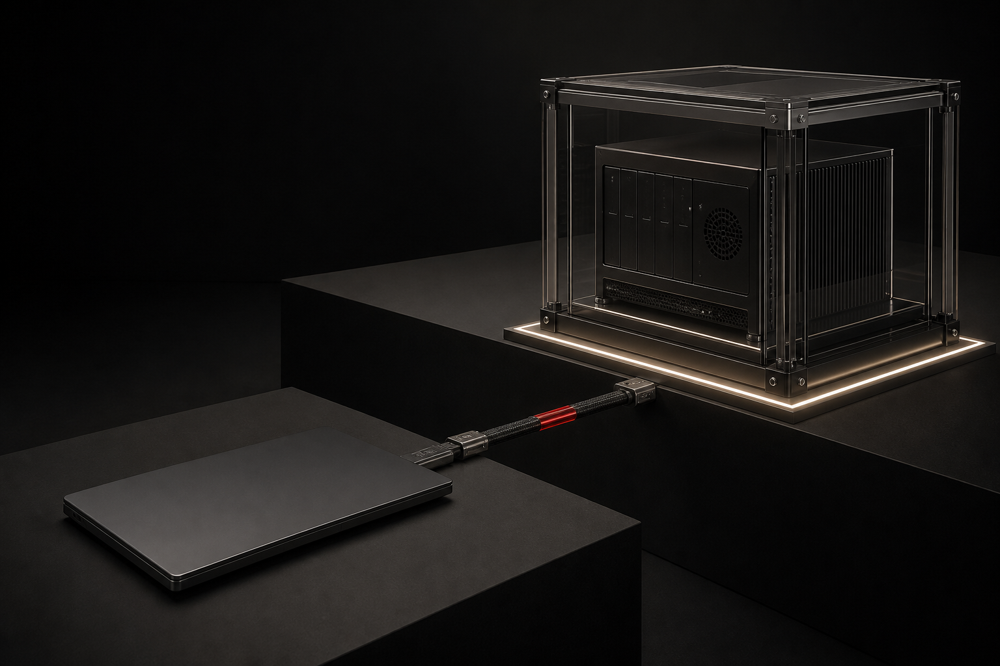
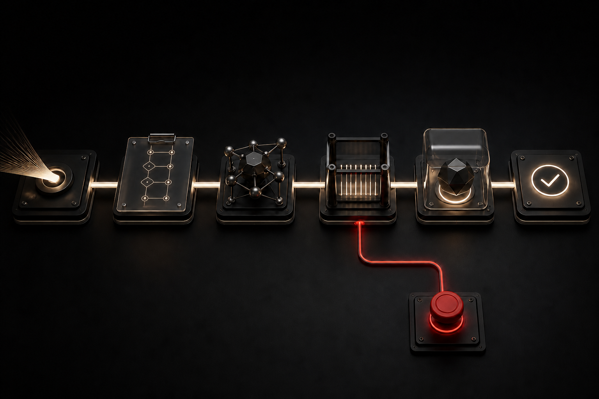

# Hivra

## Your agent needs a computer. It does not need yours.

<!--
Publication status: revised public draft, 23 October 2026.
Refresh all capability and token claims against current acceptance/deployment evidence.
Future products remain proposals unless independently verified as live.
The migration snapshot is reported complete; Doppler token launch, fee routing
and Sablier claims are not represented here as deployed or active.
This paper is not an offer or invitation to acquire a cryptoasset.
-->

There is a strange moment when an AI agent becomes genuinely useful. You stop
asking it questions and start giving it work. It opens the repository, runs
commands, installs software, signs into a browser, reads the result and changes
its plan while you do something else.

At that point, the chat box matters less. The computer matters more. Today, that
computer is usually yours.

Hivra is building a better place for the work to happen: a real computer for the
agent, away from the machine that holds your personal life and your business.
Launch it in minutes. Open it from anywhere. Watch what happens. Take control
when you want. Shut it down without wondering what got left behind.

Then build on top of it.



[Explore Hivra Agent Computers](https://hivra.cloud)

---

## I am building the product I need

I use AI agents because they are extraordinary.

I am building Hivra because I do not want extraordinary software living inside
the computer that holds my photographs, messages, browser sessions, source
code, customer information, SSH keys and recovery paths.

Yet that is the bargain most of us make. We install the agent locally because
local is easy. The files are already there. The browser is already signed in.
The terminal already works. Within minutes, the agent can reach almost
everything it needs.

Almost everything we care about is there too.

I do not want to wait for one terrible incident before asking where capable
agents should live. I want the responsible setup to feel so good that running an
agent on a personal computer starts to feel unnecessary.

That is where Hivra begins.

## The thin layer between an agent and your life

Most agent security still comes down to permissions.

A terminal asks whether a command may run. An application asks whether a folder
may be read. A cloud account limits an API key. A runtime asks for approval
before using a tool.

All of those controls matter. They answer a question about an action.

They do not answer the question that comes before it: why is this software
living beside everything else in the first place?

Suppose an agent is allowed to edit a project and run its tests. A poisoned
instruction in that project may still convince it to run a command the user has
technically approved. A malicious webpage can steer a browser-enabled agent. A
compromised dependency can reach outside the task. A broad credential can turn
one mistake into an infrastructure incident.

None of this requires a conscious machine. Malice is optional. Capability,
access and one bad interpretation are enough.

OpenAI now classifies GPT-6 Astra at the Critical level for cybersecurity
capability. Its published evaluation says Astra scored 100% on ExploitBench. In
expert-led research, it built a browser exploit chain that escaped a sandbox and
executed commands on the host, and an operating-system chain that moved from an
unprivileged user to root. Those results used Daybreak Blue research access, not
the default production configuration. OpenAI also reports stronger alignment
and monitoring. Both facts matter.

The lesson is not that every agent wants to escape. The lesson is that model
behaviour cannot carry the whole weight of computer security.

[Read OpenAI's capability report](https://openai.com/index/path-to-astra/) and
[the GPT-6 Astra system card](https://deploymentsafety.openai.com/gpt-6-astra/vision).

Hivra begins from a Christian conviction: power answers to an authority greater
than capability, convenience or profit. An AI can produce moral language. It
cannot be presumed to possess conscience, submit itself to Scripture or accept
responsibility before God. Human beings remain responsible for what we build
and what we permit it to do.

So the limits must live outside the model.

## The safer answer has always been obvious

Put the agent on another computer.

Give that computer its own network boundary. Use narrow credentials. Close the
routes it does not need. Keep a record of what happened. Make stopping and
recovery possible from the outside.

People can build this setup today. Some do. It takes another machine, careful
networking, remote access, updates, backups, monitoring and patience. A spare PC
on the same trusted network can still leave a short path back to the computer it
was meant to protect.

The architecture is sensible. The experience is terrible.

Security loses when it asks everyone to become a server administrator. Hivra
turns the stronger architecture into the easier product.

## Open Hivra. Choose what you want.

The first question should be simple.

**Do you want to launch an agent, or a computer?**

Choose an agent such as Codex, Claude Code, Hermes or another supported runtime.
Choose where it should run. Hivra prepares the computer, installs the runtime
and opens the interface that makes that agent useful. Terminal agents can stay
terminal-first. Visual agents can keep their own interface. You should not have
to create an empty project or learn a new imitation of a tool you already like.

Bounded agent launch paths exist today. The one resumable journey across every
supported destination is still being built.

Choose a computer and Hivra prepares a complete operating environment without
requiring an agent. Ubuntu is the available first path. Omarchy and Windows
are in preview, with Windows dependent on suitable owner-provided capacity
and licensing. macOS is an area of future exploration, subject to legitimate
Apple hardware and licensing.

Open the desktop. Install applications. Browse. Code. Return later from another
device. The target experience lets you attach an agent when you are ready, give
it exact access, watch it work and take the same screen back when human judgment
is needed. Attaching an agent to an existing computer is still target work.

Underneath both choices is one journey:

```text
choose Agent or Computer
        ↓
choose Hivra Cloud, your cloud, or your server
        ↓
review the real cost, boundary and planned changes
        ↓
launch and open the result
```

The visible experience can be calm because the hidden decisions are kept
precise. Connecting a cloud account does not silently authorise spending.
Inspecting a server does not silently prepare it. Preparing capacity does not
silently launch a workload. Hivra can join those steps into one flow without
turning them into one dangerous click.

Simple setup chooses a sensible allocation and the strongest compatible
isolation that has passed acceptance. Advanced setup exposes CPU, memory,
storage, placement, networking and supported isolation choices. Hivra should
name the boundary it actually used. A provider VM, a Proxmox KVM guest, an
application-kernel sandbox and a shared-kernel container are different things.

No silent downgrade. No mystery purchase. No fictional progress bar.

## A computer that belongs to the work

The agent's computer should still be there when your laptop closes.

Its files, tools and environment persist. A long task can survive an ordinary
disconnect. You can open the same machine tomorrow, from another device, and
find the work where you left it.

As the job changes, the computer can change with it. Add resources for a heavy
task. Return them when the task ends. Snapshot before a risky experiment.
Restore after a failure. Move the computer when the provider supports a truthful
migration path. Delete it with evidence that the disks, access routes and
managed resources are gone.

Creating a virtual machine is the easy part. Making the experience dependable
when a network drops, a runtime crashes or a provider answers ambiguously is the
actual product.


## The remote computer has to disappear

Nobody wants to feel like they are steering a broken office PC through a support
call.

If Hivra is going to replace local agent setups, the computer needs to feel
close. Text should remain sharp. Typing and scrolling should feel natural.
Reconnecting should recover the same machine. Taking control should happen in
the place where the agent was already working.

This is where Hivra's product moat can grow. The cloud providers can sell raw
compute. Agent companies can build better models. Hivra can own the experience
of turning distant compute into a computer people and agents are happy to use
together.

Distance still exists. Region, route, protocol, encoder, client and workload all
affect responsiveness. Hivra has to measure each path and tell the truth about
it. A fast setup screen is not proof of a fast desktop.

The standard is easy to say and hard to earn:

> The computer should feel close enough that you stop wishing the agent was on
> your laptop.

## Your cloud is welcome too

Hivra Cloud is the shortest route. Choose capacity and launch.

It cannot be the only route.

Hivra is being designed so people can connect supported cloud accounts,
prepared Proxmox environments and servers they control. Operators will be able
to run the functional control plane themselves without a Hivra Cloud account.
The current product has bounded managed, owner-connected and local
source-checkout paths. Complete self-host packaging, recovery, upgrades and
movement between modes still need more work.

Managed Hivra should win because it is smooth and dependable. It should never
need a hidden, better version of the platform to trap people there.

Hivra's source is published under Apache 2.0 and can be inspected or built upon.
A source-based self-host preview exists without requiring a token or Hivra Cloud
subscription. That is distinct from a polished, fully supported self-host
installation: packaging, recovery and upgrades remain work in progress.

## Every run should leave evidence

An agent can explain what it did. That explanation is useful. It is also written
by the system being supervised.

Hivra's evidence layer is meant to connect the original request to what the
computer actually exposed and observed:

```text
request
  → agent and computer identity
  → access available at the time
  → approvals and interventions
  → observed commands, files, browser actions and messages
  → restarts, failures and recovery
  → artifacts and final state
```

The aim is deep observability where Hivra can mediate or instrument the action.
That boundary matters. Hivra cannot see into an unrelated encrypted channel or
read a model's mind. It can make the surrounding computer far less mysterious.

Evidence creates its own responsibility. Logs may contain code, filenames,
commands and business context. They need isolation, encryption, redaction,
retention controls and deletion. Surveillance is not the price of safety.



Every run should leave enough truth for a person to answer: what happened, what
changed, what remains, and what can I do now?

## One computer opens the door to a platform

A separate computer solves the first problem. A network of carefully separated
computers creates a new category of product.

Several agents can work at once without sharing one laptop, one root account or
one invisible pool of credentials. A task can move to the agent suited to it. A
human can see where the work is happening, inspect the handoff and stop one part
without killing everything else.

Communication between agents becomes an explicit object. One computer can send
a message or artifact to another without handing over its whole authority.
Memory can be shared by reference, with scope and provenance, instead of copied
into every agent by default.

That is the larger thesis behind Hivra.

Agent Computers is the flagship. Hivra is the umbrella around the things those
computers will need as they become useful enough to do serious work.

## The Hivra system

The wider map grows in layers. Most of these products are exploratory. The map
shows direction, not pretend shipping progress. Gate, Exchange, Arena and Signal
are among the next areas Hivra intends to explore; they are not live products.

### Place, identity and control

**Agent Computers** gives each agent somewhere to work. **Hivra Capacity**
connects the compute underneath it. **Hivra Gate** can hold consequential
approvals and credentials outside the runtime. **Hivra Names** can give agents
and computers stable addresses without publishing a directory of targets.

### Communication and experience

**Buzz** already has bounded integration evidence as an optional collaboration
surface. The broader **Hivra Relay** idea is deliberate communication across
separate computers. The **Experience Network** can move signed, reviewable
workflows and machine experience between approved environments.

Knowing an address never creates trust. Receiving a message never grants
permission. Importing experience never installs itself.

### Software, work and organisations

**Hivra Exchange** can distribute runtimes, tools, computer profiles and
extensions with provenance, versioning and revocation. **Hivra Missions** can
organise funded objectives around a named sponsor, an exact budget and accepted
evidence. **Hivra Foundry** can become an operating layer for founders building
agent-native companies with explicit charters and human control from day one.

**Hivra Colony** can test persistent multi-agent organisations inside capped,
resettable environments before similar systems receive real money or broad
reach.

### Commerce and the physical edge

**Hivra Interchange** can give agents exact-purpose financial authority without
sharing an owner's primary keys. A future **Agent Business Exchange** could make
an operating system for a business reproducible through clean transfer of
workflows and infrastructure, without selling a live identity or customer data.
**Hivra Ports** can connect bounded systems to approved services, devices and
human operators.

Each part should be useful on its own. Builders may use Hivra end to end, host
one module themselves, add a runtime or provider, publish a computer profile, or
create something Hivra never anticipated.

That is how Agent Computers grows into infrastructure.

**LaunchPad (future).** Another initiative we're exploring would bring AI
agents, creators and communities together around new projects, with ways to
support promising builders. The practical details are still being worked
through. Nothing is available to launch through LaunchPad today.

## An economy for work the system can prove

An agent running on a computer is a product. A network of agents, tools,
builders and independent operators could become an economy. But a token does
not become useful merely because we give it a name.

$HIVRA is planned as the successor to $HermesOS on Base. It is intended to
support optional token payments and service access, with further uses possible
as Hivra's products become real. Today, existing $HermesOS service features
are a separate matter from the not-yet-active $HIVRA launch. Hivra Cloud also
accepts ordinary payment methods, and self-hosting does not require a token.

The longer-term possibilities include payments for metered computing, published
tools, verified security work and approved tasks between independent parties.
They are directions, not benefits promised to someone who holds a token.
Where a card or stablecoin works better, we should use it.

### Why the new token has a different structure

I originally intended to keep $HermesOS. As the product changed, I decided
that Hivra needed more independence over the launch arrangements, trading-fee
routing and long-term development. $HIVRA is therefore intended to launch
independently through Doppler rather than through the earlier Bankr conversion
plan. Launch configuration and contracts must still be verified before the
new token is described as live.

**No founder allocation of new $HIVRA tokens is planned.** That does not mean
there is no founder compensation. A disclosed trading-fee share is intended
to support the founder and ongoing operations.

The chosen *target* trading fee is approximately **1.58% in total**:

| Use | Intended percentage of each trade |
| --- | ---: |
| Founder and Hivra operations | **1.20%** |
| Reserved for adding and locking liquidity | **0.30%** |
| Doppler protocol share | **approximately 0.08%** |
| **Total** | **approximately 1.58%** |

These figures describe the intended allocation as a percentage of trading
volume, not the share of a smaller fee pool. The protocol portion, total fee,
recipient addresses and any additional charges need confirmation against the
final deployed contracts before launch.

The **0.30% liquidity portion is not automatically locked**. The plan is to
collect it separately, potentially in a dedicated Safe wallet, then
periodically add and lock liquidity using established infrastructure. Hivra
intends to publish regular, preferably weekly, records of what was received,
what was added, where it was locked and what is still awaiting deployment.
Money sitting in a Safe wallet is not itself locked liquidity. None of this
guarantees price stability, active liquidity at every price or returns to
holders. There is no planned programme of trading-fee-funded buybacks, holder
revenue distributions or price support.

### The $HermesOS migration

The snapshot of eligible $HermesOS holdings has already been completed.
Eligible wallets are planned to receive a **1:1 allocation of $HIVRA**, claimed
through Sablier rather than delivered automatically. Holders will need to
claim for themselves and pay the applicable claim and network fees.

The intended claim period is **90 days from the verified claim opening**, not
90 days from the publication of this paper. Holders will **not** need to
surrender or burn their existing $HermesOS. A 1:1 token quantity is not a
promise of equivalent market price.

For the founder-controlled $HermesOS balance, the plan is to wait an initial
**two weeks**, then sell **500 million $HermesOS per week for approximately
three months**. Any founder-held tokens remaining after that schedule will
be burned. The exact dates, wallets and on-chain records will be published.
The founder sale schedule and the 90-day claim period are separate timelines;
with the two-week wait, they may not end together. The claim rules, expiry
procedure and treatment of unclaimed $HIVRA still need final confirmation.
Burning founder-controlled tokens does not burn other holders' tokens or
erase the old contract.

**Until launch and claims actually open, neither trading nor claiming should
be described as live.** The authoritative place for contracts, exact times,
wallet instructions and warnings will be
[Hivra's token information page](https://hivra.cloud/token). Ignore claim
addresses supplied through unsolicited messages or replies.

Existing holders who use $HermesOS for access or payment need a separate,
explicit explanation of how those benefits carry over. The snapshot claim
alone does not determine service entitlements.

### Boundaries that do not change

No token ownership is necessary to self-host Hivra. Holding $HIVRA will not
grant control of users' computers or weaken security boundaries. The token
is not equity, a dividend, a revenue claim or a guarantee of financial return.
Future capabilities will be described as available only when the service,
price, safety arrangements and legal route are real.

The UK cryptoasset financial-promotion and other regulatory requirements need
specialist review before public token marketing and claim flows go live.
A disclaimer or geographic block is not by itself a complete compliance route.

[Read the FCA's cryptoasset overview](https://www.fca.org.uk/firms/cryptoassets)
and [registration guidance](https://www.fca.org.uk/firms/cryptoassets/who-needs-register).

## Move at AI speed. Publish at evidence speed.

AI changes how much a small team can build in six months. A roadmap padded to 24
months can become obsolete before the first quarter ends.

Hivra will work in dense waves that can overlap when the foundations allow it.
The clock measures working outcomes.

### Make launch feel inevitable

One Agent or Computer choice. One resumable journey. Hivra Cloud, a supported
cloud account or a supported server. Immediate access to the real result.
Honest failure and verified cleanup.

### Make the computer worth using every day

Finish the Ubuntu path. Measure responsiveness. Prove reconnection, lifecycle
and recovery. Add Omarchy and Windows only through their own acceptance gates.
Package the same control plane for web and later native clients without creating
separate products underneath.

### Make control undeniable

Connect requests, approvals, observed actions, artifacts and outcomes. Add
human takeover, bounded stops, revocation and recovery. Make communication
between computers deliberate and inspectable.

### Open the builder layer

Publish the contracts for runtimes, providers, profiles, tools and policies.
Prove Exchange, Experience, Missions and Foundry through small working slices.

### Activate economics through use

Complete the snapshot-based $HermesOS migration and verify the Doppler launch,
fee routes and 90-day Sablier claim campaign. Publish final supply, controller
and contract details only once they are verified. Introduce further token uses
only when there is a real service and a lawful operating path.

Fast code cannot compress provider access, operating-system licences, security
review or sustained reliability into a slogan. AI speed should make each wave
denser. It should never make the evidence weaker.

## A constitution written before the power arrives

The wider system is exciting because its parts can connect.

Computers create persistence. Relay creates coordination. Experience makes
capability reusable. Missions create durable goals. Interchange creates spending
power. Foundry creates organisations. Ports create physical reach.

That combination can become more dangerous than any one product.

Hivra begins with one conservation rule:

> A child agent, delegated task, connected product or token action cannot create
> more authority than an accountable principal deliberately supplied.

The network should have no universal master key. Emergency controls can deny,
pause, quarantine and revoke. They cannot quietly become a fleet-wide command
channel. A model, customer, employee, company key, token vote or government
order should never be enough on its own to turn the whole system into one
offensive machine.

Hivra itself belongs inside the threat model.

Security is the constitution under the opportunity. It keeps Hivra useful when
individual agents, operators or institutions fail. It also keeps every later
product honest about the authority it creates.

## Somewhere better to work

Agents will operate more software, hold more context, work for longer and
cooperate across more systems. Keeping each one beside everything we value and
trusting the next permission prompt is not a serious long-term answer.

Give the agent a computer of its own.

Make it easy enough to launch, fast enough to enjoy, open enough to leave and
observable enough to supervise. Then let people build tools, networks,
marketplaces and companies on top of a boundary that existed before the power
arrived.

**Agent Computers is where Hivra starts. The operating layer for accountable
autonomous systems is where it can go.**

[Explore Hivra Agent Computers](https://hivra.cloud) · [Read the full Hivra White Paper](WHITEPAPER.md)
